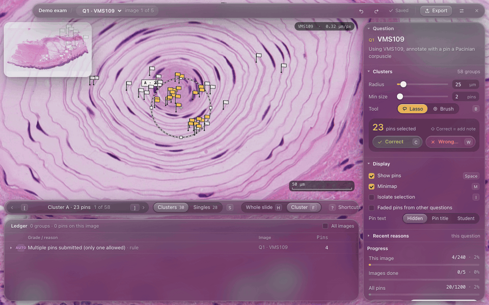

<p align="center"></p>

# Micro Speed Grader

Grade histology practical exams **one question at a time**. Every student's pin for a
question is shown on the whole-slide image at once, grouped into clusters, and graded in bulk.
Export goes to a D2L-ready CSV plus per-student feedback.

<p align="center">
  
</p>

## Download

**macOS (Apple Silicon):** grab the `.dmg` from [Releases](../../releases), open it and drag the app to
Applications. OpenSlide is bundled, so nothing else needs installing. The build is signed and notarized,
and the app updates itself from new releases (**Micro Speed Grader → Check for Updates…**).

## Features

The full user guide is in [docs/help](docs/help/index.md); the same pages are built into the app (Help ▸ Micro Speed Grader Help, ⌘?).

- Opens NDP.view slides (`.ndpi`, plus other OpenSlide formats) and student `.ndpa` annotations
- Clusters answers by distance (µm), largest first; jump between clusters and single pins
- Grade with the keyboard: **C** correct, **W** wrong + reason (recent reasons are one key away)
- Lasso, paint-brush and ⌘-click selection; drag or resize the cluster ring
- Crowded clusters: hide the pins and paint the true structure (painted ✓, rest of cluster ✗ in one
  key), or step through a cluster pin by pin; also polygon outlining, spotlight-on-hover and small
  pins when zoomed in. Each is toggled in Preferences → Selection, which shows a short demo of each
- Auto-flags students who submit more than one pin per question
- Ledger of every grading decision with undo/redo, editable afterwards
- Autosave with crash recovery; CSV + feedback export
- Export layout you arrange (drag columns; UID, surname, first name, correct / total, comment, one
  1/0 column per question) and a Statistics tab with KR-20 and item statistics (difficulty,
  point-biserial, KR-20 if deleted), saved as item-stats.csv
- Feedback wording edited in place on a live "Student sees" preview (Preferences → Grading text)
- Grade with other people: the host hands off part of the remaining images to any number of graders
  as pack files (drag images between people, or split evenly by pin count); those pins lock until each
  grader's results file is imported, and the host can recall a pack at any time ([how it works](docs/help/handoff.md))

## Run

Needs Node, Rust and OpenSlide (`brew install openslide` on macOS; on Windows put
`libopenslide-1.dll` next to the app or set `OPENSLIDE_LIB`).

```
cd app
npm install
npm run tauri dev      # run the app
npm run tauri build    # build an installer
```

On macOS, run `tools/bundle-openslide-mac.sh` once before `tauri build`: it copies OpenSlide and its
libraries out of Homebrew into the app bundle.

## Demo class

Slides are not in the repo. Put the `.ndpi` files in `images/`, then generate a fake class from
the demo answer key:

```
node tools/simulate.mjs --key demo-key --spec demo-key/demo.json --out demo
```

In the app: **New grading session** → `demo/exam.json`, `demo/submissions`, `images/`.

## Tests

Both need the demo class (see above). The UI tests also need the slides in `images/`; they start a small tile server themselves (Rust toolchain), and the app's dev server (`npm run dev`) must be running.

```
cd app
npm run test:logic     # parsing, clustering, grading rules, hand-off, help links
npm run test:ui        # clicks through the real UI in a headless browser
(cd src-tauri && cargo test)   # Rust: tile paths (add -- --ignored to render a real slide)
```

Help images and GIFs are recorded from the demo class (needs `ffmpeg`; dev server running):

```
node tests/ui/record-gif.mjs             # docs/demo.gif (the README animation)
node tests/ui/record-help-gifs.mjs       # selection-tool clips in docs/help/img
node tests/ui/record-wiki-media.mjs      # wiki screenshots; pass file names to redo only those
```

## Releasing (macOS)

```
tools/release-mac.sh 0.3.0 "What changed"
```

Builds, signs, notarizes and publishes a GitHub release with the DMG and the updater files
(`latest.json`, signed `.app.tar.gz`). Needs the Developer ID certificate, a `notarytool` keychain
profile named `notary`, and the updater key at `~/.tauri/micro-speed-grader.key` (keep it backed up:
without it, installed copies can't be updated).

## License

[MIT](LICENSE)
