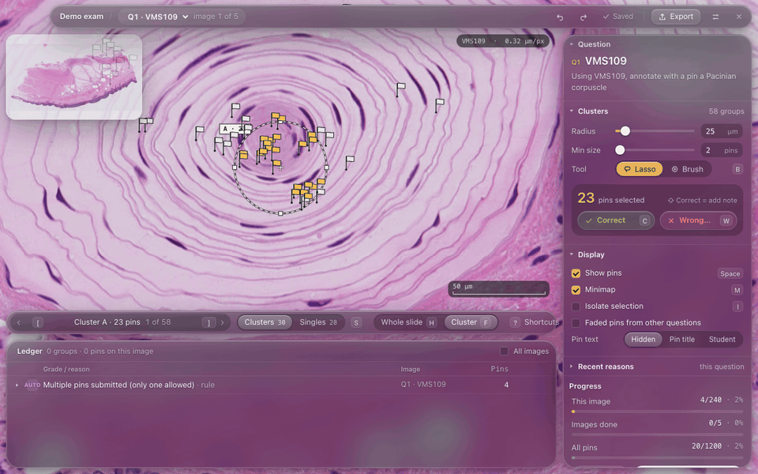

# Micro Speed Grader

Grade histology practical exams **one question at a time**. Every student's pin for a
question is shown on the whole-slide image at once, grouped into clusters, and graded in bulk.
Export goes to a D2L-ready CSV plus per-student feedback.



## Features

- Opens NDP.view slides (`.ndpi`, plus other OpenSlide formats) and student `.ndpa` annotations
- Clusters answers by distance (µm), largest first; jump between clusters and single pins
- Grade with the keyboard: **C** correct, **W** wrong + reason (recent reasons are one key away)
- Lasso, paint-brush and ⌘-click selection; drag or resize the cluster ring
- Auto-flags students who submit more than one pin per question
- Ledger of every grading decision with undo/redo, editable afterwards
- Autosave with crash recovery; CSV + feedback export

## Run

Needs Node, Rust and OpenSlide (`brew install openslide` on macOS; on Windows put
`libopenslide-1.dll` next to the app or set `OPENSLIDE_LIB`).

```
cd app
npm install
npm run tauri dev      # run the app
npm run tauri build    # build an installer
```

## Demo class

Slides are not in the repo. Put the `.ndpi` files in `images/`, then generate a fake class from
the demo answer key:

```
node tools/simulate.mjs --key demo-key --spec demo-key/demo.json --out demo
```

In the app: **New grading session** → `demo/exam.json`, `demo/submissions`, `images/`.

## Tests

```
cd app
npm run test:logic     # parsing, clustering, grading rules
npm run test:ui        # clicks through the real UI in a headless browser (dev server must be running)
```

## License

[MIT](LICENSE)
