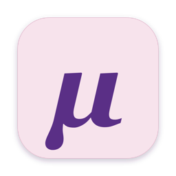

<p align="center"></p>

# Micro Speed Grader

Grade histology practical exams **one question at a time**. Every student's pin for a
question is shown on the whole-slide image at once, grouped into clusters, and graded in bulk.
Export goes to a D2L-ready CSV plus per-student feedback.

<p align="center">
  
</p>

## Download

From [Releases](../../releases). OpenSlide is bundled, so nothing else needs installing, and the app
updates itself from new releases (**Check for Updates…** in the app menu).

- **macOS** (Apple silicon and Intel, macOS 12+): the `.dmg`. Open it and drag the app to Applications.
  Signed and notarized.
- **Windows** (64-bit, Windows 10+): the `Windows-x64-setup.exe`. It installs for your user only, no
  admin rights needed. It isn't code-signed yet, so Windows may say it "protected your PC": click
  **More info → Run anyway**.

## Features

The full user guide is on the [wiki](https://github.com/agadin/micro-speed-grader/wiki); the same pages are built into the app (Help ▸ Micro Speed Grader Help, ⌘?). They are written in [docs/help](docs/help/index.md).

- Opens NDP.view slides (`.ndpi`, plus other OpenSlide formats) and student `.ndpa` annotations
- Clusters answers by distance (µm), largest first; jump between clusters and single pins
- Grade with the keyboard: **C** correct, **W** wrong + reason (recent reasons are one key away)
- Lasso, paint-brush and ⌘-click selection; drag or resize the cluster ring
- Crowded clusters: hide the pins and paint the true structure (painted ✓, rest of cluster ✗ in one
  key), or step through a cluster pin by pin; also polygon outlining, spotlight-on-hover and small
  pins when zoomed in. Each is toggled in Preferences → Selection, which shows a short demo of each
- Answer key: paint where the right answer and common wrong answers are, per question and slide, and
  matching pins are graded for you (or only suggested), now and as late work comes in; reusable as a
  `.msgkey` file ([how it works](docs/help/answer-key.md))
- Rescan submissions picks up late and changed work without losing grades
- Auto-flags students who submit more than one pin per question
- Ledger of every grading decision with undo/redo, editable afterwards
- Autosave with crash recovery; CSV + feedback export
- Export layout you arrange (drag columns; UID, surname, first name, correct / total, comment, one
  1/0 column per question) and a Statistics tab with KR-20 and item statistics (difficulty,
  point-biserial, KR-20 if deleted), saved as item-stats.csv
- Feedback wording edited in place on a live "Student sees" preview (Preferences → Grading text)
- Grade with other people: the host hands off part of the remaining images to any number of graders
  as pack files (drag images between people, or split evenly by pin count); those pins lock until each
  grader's results file is imported, and the host can recall a pack at any time ([how it works](docs/help/handoff.md))

## Run

Needs Node and Rust. Fetch OpenSlide once (the official prebuilt library, pinned and checksummed):
`tools/fetch-openslide.sh mac` or `tools/fetch-openslide.sh windows` (from Git Bash).

```
cd app
npm install
npm run tauri dev      # run the app
npm run tauri build    # build an installer
```

Tests: `npm run test:logic` (fast, no slides needed), `npm run test:ui` (drives the app in a browser;
needs the dev server and the demo class), `npm run test:real` (checks the readers against real exam
PDFs and answer keys in `reference/` and `sample-data/`, when they're on the machine) and
`npm run test:scale` (times the heavy work on a generated 400-student class; see the file for how to
make one). GitHub Actions run the type check, logic tests and build on every change, and build and
smoke-test macOS (both chips) and Windows when the native side changes.

## Demo class

Slides are not in the repo. Put the `.ndpi` files in `images/`, then generate a fake class from
the demo answer key:

```
node tools/simulate.mjs --key demo-key --spec demo-key/demo.json --out demo
```

In the app: **New grading session** → `demo/exam.json`, `demo/submissions`, `images/`.

## Tests

Both need the demo class (see above). The UI tests also need the slides in `images/`; they start a small tile server themselves (Rust toolchain), and the app's dev server (`npm run dev`) must be running.

```
cd app
npm run test:logic     # parsing, clustering, grading rules, hand-off, help links
npm run test:ui        # clicks through the real UI in a headless browser
(cd src-tauri && cargo test)   # Rust: tile paths (add -- --ignored to render a real slide)
```

Help images and GIFs are recorded from the demo class (needs `ffmpeg`; dev server running):

```
node tests/ui/record-gif.mjs             # docs/demo.gif (the README animation)
node tests/ui/record-help-gifs.mjs       # selection-tool clips in docs/help/img
node tests/ui/record-wiki-media.mjs      # wiki screenshots; pass file names to redo only those
```

## Releasing

```
tools/release.sh 0.3.7 "What changed"
```

Builds a universal macOS app, signs and notarizes it, has the Build workflow on GitHub make the
Windows installer, signs both for the updater, and publishes a GitHub release with the DMG, the
Windows installer and the updater files (`latest.json`, signed `.app.tar.gz` and `.exe`). Follow the
steps in [CLAUDE.md](CLAUDE.md). Needs the Developer ID certificate, a `notarytool` keychain
profile named `notary`, and the updater key at `~/.tauri/micro-speed-grader.key` (keep it backed up:
without it, installed copies can't be updated).

## License

[MIT](LICENSE)
