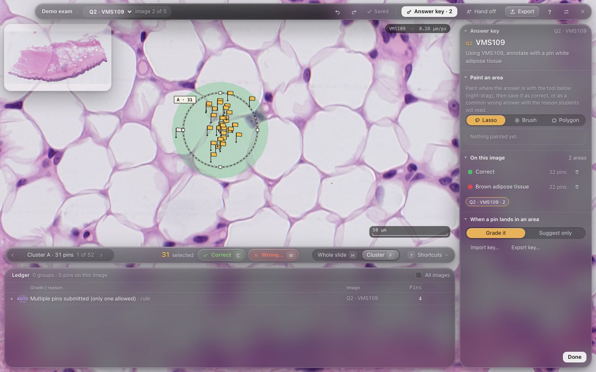
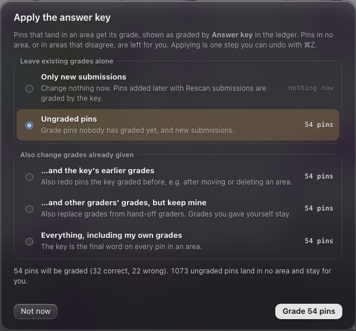

# Answer key

Most students put their pin in one of a few places: the right structure, or one of two or three common mistakes. Mark those places once, and every pin that lands in them is graded for you. That includes work handed in late. What's left is the unusual answers, which need a person.

## Mark the answers

1. Click **Answer key** in the top bar. The slide stays as it is, with the students' pins showing, so you can see where most of them clicked.
2. Paint the area where the answer is, with the lasso, brush or polygon (right-drag, or whichever button selects for you). Paint several strokes to build up one area. To rub part of it out, hold **⌥** with the brush, or **⇧** with the lasso or polygon.
3. The panel shows how many student pins are inside. Save the area:
   - **✓ Correct here** (**C**): pins in this area are right.
   - **✗ Wrong**: type what the students marked instead, for example *Neutrophil*, and press **↵**. That reason goes into their feedback, exactly like a reason you type while grading. **W** jumps to the box.
4. Repeat for every common answer, then move to the next image with the menu in the top bar or **⌘→**.
5. Click **Done**. You're asked what the key should apply to (see below).

**On this image** lists the areas you've made, with how many pins each one covers. The trash button deletes one. The chips underneath show which other images have areas; click one to go there.

> Paint generously around the right structure, but not over its neighbours. A pin counts if its point is inside the area.

### Questions with two slides

A question like *"Using VMS262 or VMS263, …"* has an image for each slide. Mark the answer on each one: switch slides with the menu in the top bar. A pin on VMS263 is checked against the VMS263 areas only.

### When areas overlap

If a pin lands in areas that say different things (a correct area and a wrong one, or two wrong answers with different reasons), the key leaves that pin for you.

## Apply the key

When you click **Done** (or change the key later), you choose how far the key reaches. Each choice shows how many pins it would change, so you can see before you commit.

**Leave existing grades alone**

- **Only new submissions**: change nothing now. Pins added later with [Rescan submissions](getting-started.md#new-and-changed-submissions) are graded by the key.
- **Ungraded pins**: grade every pin nobody has graded yet, and new submissions. This is the usual choice.

**Also change grades already given**

- **…and the key's earlier grades**: also redo pins the key graded before. Use this after moving, adding or deleting an area: pins the key graded that are no longer in any area become ungraded again.
- **…and other graders' grades, but keep mine**: also replace grades from people you [handed work to](handoff.md). Grades you gave yourself stay.
- **Everything, including my own grades**: the key is the final word on every pin in an area.

Grades from the key show **Answer key** in the [ledger](ledger.md), and you can change or remove them like any other grade. Applying the key is one step you can undo with **⌘Z**.

The key never grades:

- a student who placed more than one pin for the question (the [double-pin rule](grading.md#double-pins) applies);
- pins that are out with another grader, or that are being [graded twice](handoff.md#grade-some-pins-twice).

## Grade or suggest

In the key panel, **When a pin lands in an area** has two settings:

- **Grade it** (the default): matching pins get the key's grade straight away.
- **Suggest only**: nothing is graded automatically. While you grade, a bar over the slide shows what the key says about the current cluster (for example *Answer key ✓ 18 ✗ Neutrophil 3, 2 not in the key*). Press **K** or click **Use key** to accept it.

The areas are shaded on the slide while you grade: green where the answer is right, red for common wrong answers. Turn that off with **Answer key areas** in the right panel's Display section.

## In a new session

The last step of **New grading session** is **Answer key (optional)**:

- **Import key…** loads a key saved from another session. Its areas grade matching pins as soon as grading starts.
- **Start by marking the answer key** opens the key editor first, so you can mark the common answers before grading anything.

## Reuse a key

In the key panel, **Export key…** saves the key as a `.msgkey` file. Use **Import key…** (in the key panel, or in a new session) to reuse it for the same exam next term, or to share it with another instructor.

Areas for questions or slides the session doesn't have are skipped, and the app says how many. If the key already has areas, you can replace them or add the imported ones alongside.

## With other graders

The key and [hand-off packs](handoff.md) work together:

1. Mark the key and apply it to **Ungraded pins**.
2. Open **Hand off**. Only pins the key didn't grade are left to share, so each grader gets just the unusual answers.

The pack also carries your key as suggestions, so other graders see the same areas while they grade.

## New submissions

When late work arrives, choose **File ▸ Rescan Submissions** (or **Rescan submissions** under Progress). New pins that land in an area are graded by the key straight away, unless the key is set to **Suggest only**. See [New and changed submissions](getting-started.md#new-and-changed-submissions).
