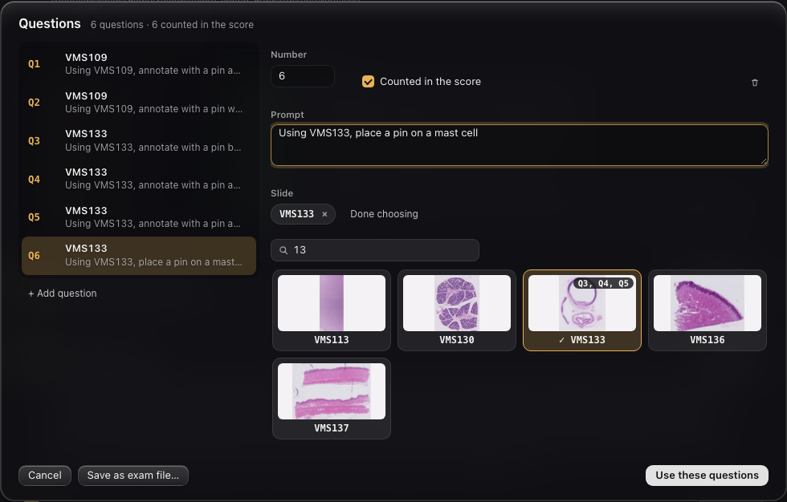

# Set up exam questions

The app reads the questions from the exam PDF (lines like `Q1. Using VMS109, …`) or from an exam file. When that doesn't work, or gets something wrong, set the questions up yourself in the question editor.

## Before grading starts

In **New grading session**, step 1:

- **Edit questions…** (after choosing the exam) opens the editor with the questions that were read, so you can fix and add to them.
- **Set up the questions by hand** (when you have no exam file) opens it empty.

For each question:

- **Number**: the question number students used in their pin titles (e.g. *Q3*).
- **Prompt**: what the question asks. It's shown while grading.
- **Slide**: click **Choose slide…** and pick it from the slides folder (see below). Add a second slide for questions students can answer on either one (*Using VMS262 or VMS263…*).
- **Counted in the score**: untick to leave a question out; the score is out of the questions that are counted.
- **Mark its answer when grading starts**: grading then opens in the [answer key](answer-key.md) editor on this question, so you can paint the right answer before grading anything.

**+ Add question** adds one at the end with the next number, and the trash button removes one. Click **Use these questions** when you're done.

### Reorder and renumber

Before grading starts you can drag questions into a different order. Their numbers follow the new order (1, 2, 3…), and the first time you're asked to confirm.

> Students' pins are matched to questions by the number in their title, so only renumber if the numbers in the editor don't match the exam the students had (for example when the PDF was read wrongly).

### Problems

The editor lists anything that would stop it being used, such as two questions with the same number, a question with no slide, or a slide ID that isn't like *VMS109*. It also lists things to look at, such as a slide that isn't in the slides folder or a question with no prompt.

## Choose slides

**Choose slide…** shows every slide in the slides folder as a thumbnail. Type part of the ID (e.g. *109*) to narrow the list. Click a slide to use it, and click it again to take it off. A small **Q** label shows which other questions already use a slide.

Pick the slides folder (step 3) first, or the list is empty.

## Save as an exam file

**Save as exam file…** saves the questions as a `.json` exam file. Next term, choose it with **Choose exam PDF / JSON…** and the questions come back exactly as you set them up.

## Inside a session

Forgot a question, or set one up wrong? Choose **File ▸ Edit Questions…**, or click **Edit questions…** under the question in the right panel.

> Changing the questions of an exam that's being graded is risky: it can change which question a student's pin answers, and grades for a question you remove stop counting. The editor shows a red warning while you edit.

Inside a session you can:

- add a forgotten question;
- change a question's prompt or slides;
- count a question in the score or leave it out (its grades are kept);
- remove a question.

The numbers of questions that are already being graded can't be changed, because students' pins are matched by the number in their title.

When you click **Review changes…**, the app reads the submissions folder again with the new questions and shows what would happen before anything changes:

- **New pins to grade**: e.g. pins on a slide a question now uses, or pins titled with a question you added.
- **Graded pins that now answer a different question**: their grade is removed, so you can grade them again under the right question.
- **Pins no longer used**: e.g. on a slide you took off a question. Their grades are kept aside.
- **Grades for removed questions**: these stop counting.

**Apply changes** first saves a copy of the session next to it, named *“… (before question edit …).msgrade”*, then applies the change. Undo history starts again afterwards; to go back, open the saved copy with **Open session…**.

**Mark the answer on the slide…** jumps straight to the [answer key](answer-key.md) editor for that question (apply any changes first).
