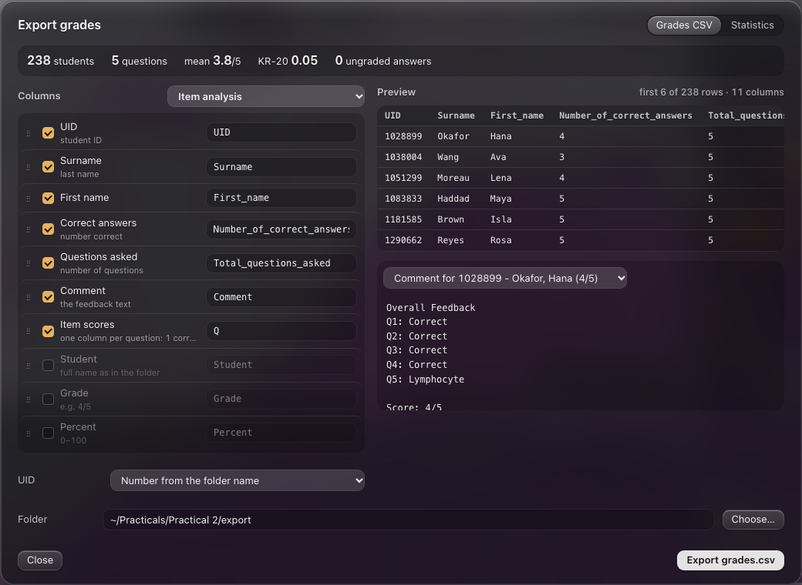
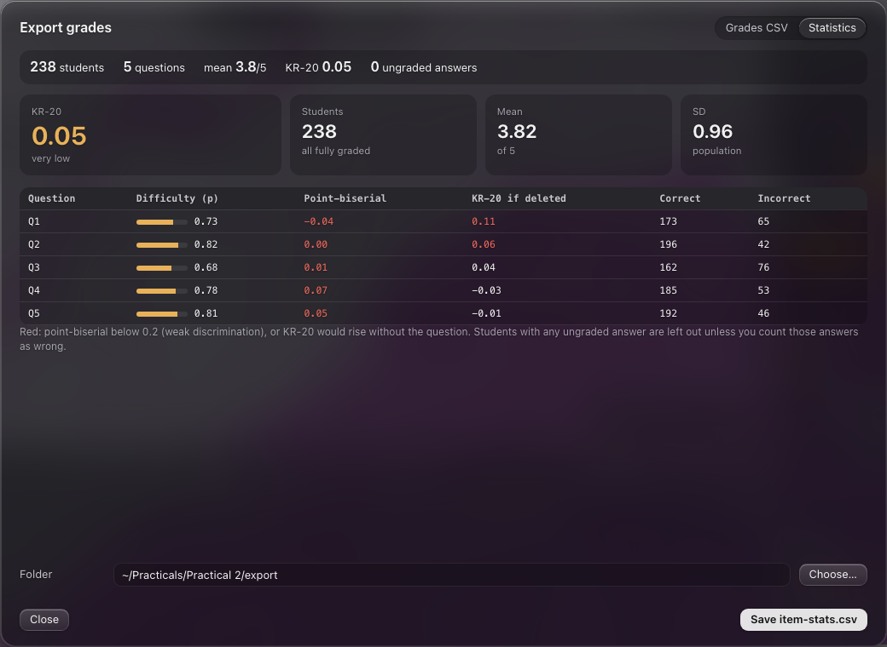
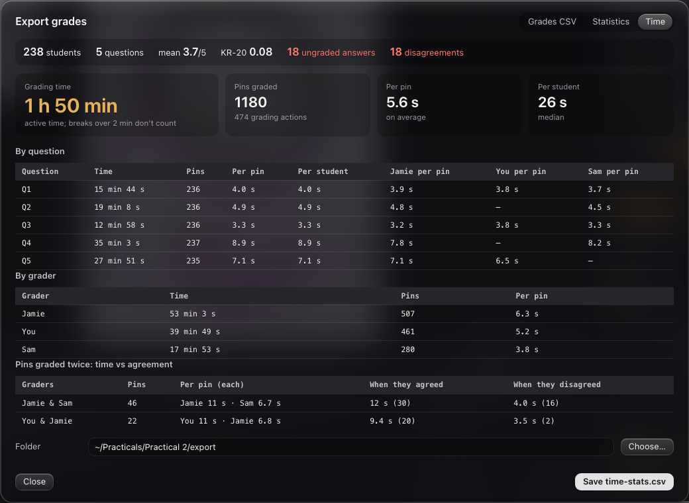
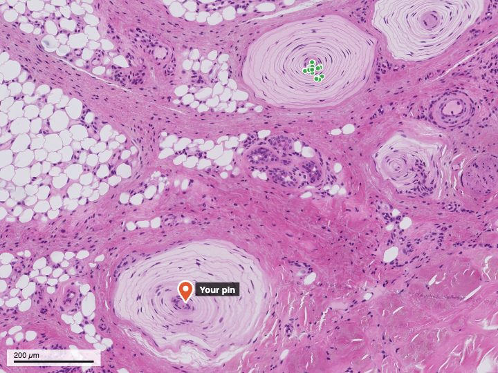
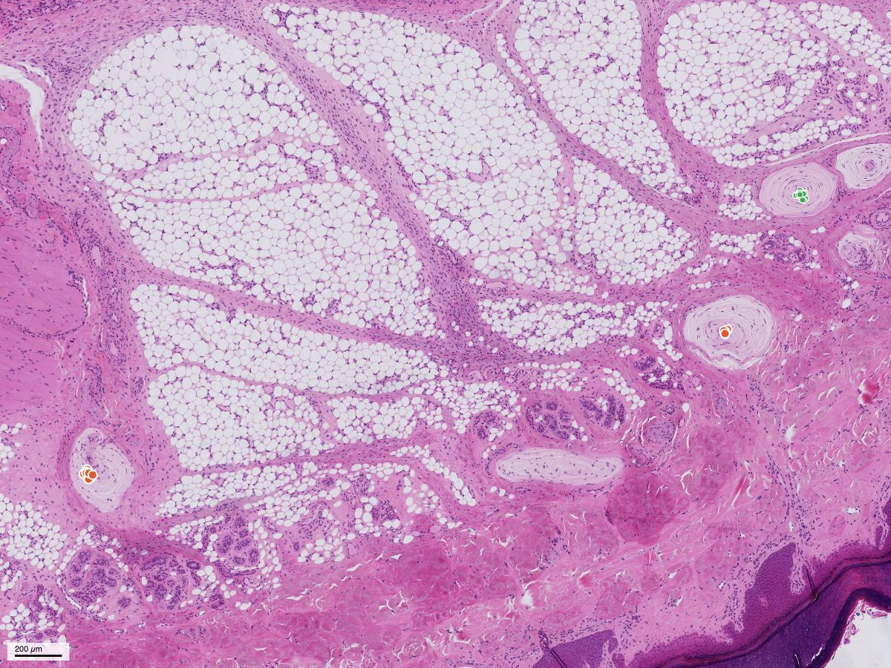

# Exporting grades

Click **Export** in the top bar (or **File ▸ Export Grades…**, **⌘E**). You can export at any time; ungraded answers are flagged.

The strip at the top summarises the class: students, questions, the mean score, KR-20 reliability, and how many answers are still ungraded.

## Grades CSV

Click **Export grades.csv** to write the file into the folder shown at the bottom (by default an `export` folder next to the session file; **Choose…** to change it).

### Choosing columns

Each column can be turned on or off, renamed, and dragged into a different order. You can also drag the column headers in the preview table. The **Columns** menu has two presets:

- **Item analysis**: UID, surname, first name, number correct, questions asked, the comment, and one 1/0 column per question.
- **Simple (Student, Grade, Comment)**.

| Column | Contains |
| --- | --- |
| UID | The student number from the folder name |
| Surname, First name | Split from the folder name |
| Student | The full folder name |
| Correct answers | Number right |
| Questions asked | Number of included questions |
| Grade | For example *4/5* |
| Percent | 0–100 |
| Comment | The student's feedback text ([What students see](feedback.md)) |
| Item scores | One column per question: 1 correct, 0 wrong |

Options:

- **UID**: the number from the folder name, or blank.
- **Ungraded items**: leave blank, or count as 0.
- **Also write feedback/<student>.txt**: one text file per student, ready to upload as feedback.

The layout is saved and also editable in [Preferences ▸ Export](preferences.md#export).

The CSV is UTF-8 and opens directly in Excel. Text that a spreadsheet could mistake for a formula is written safely.

## Statistics

The **Statistics** tab shows how the exam performed:

- **KR-20**: the test's reliability (0–1), with a reading from *very low* to *good*.
- **Mean** and **SD** of the scores, and the **SEM** (standard error of measurement, SD × √(1 − KR-20)): roughly how many points a student's score could move on a retest.
- For each question:
  - **Difficulty (p)**: the share of students who got it right.
  - **Discrimination (D)**: p among the top 27% of scorers minus p among the bottom 27%. Hover it for the two values. Below 0.2 is shown in red, 0.3 and up in green.
  - **Point-biserial (corrected)**: the correlation between the question and the rest of the test. Below 0.2 is shown in red.
  - **KR-20 if deleted**: reliability without that question. Red when leaving it out would make the test more reliable.

**Answers and feedback by question** lists, for every student (graded or not), how many got each question right and wrong, how many had no pin, how many had several pins, and how many are still ungraded, with the three most common pieces of feedback. Feedback that differs only in capitals counts as one.

If some answers are ungraded, choose **Leave those students out** or **Count ungraded as wrong**. At least two fully graded students are needed. **Save item-stats.csv** writes the summary, the per-question statistics, the answer counts and every piece of feedback with its count to the export folder.

## Time spent

The app quietly keeps track of how long grading takes. You never see it while grading; it shows up only here, as a **Time** tab in the Export window, once some grading has been done.

- **Grading time**: total active time. Each grading action counts the time since the previous one, or since the image was opened. Gaps longer than 2 minutes count as 2 minutes, so breaks don't inflate it.
- **By question**: time, pins, time per pin and per student for each question. Slow questions are often ambiguous ones.
- **By grader**: when you [handed work to other graders](handoff.md), their time comes back in their results file, so you can compare time per pin.
- **Pins graded twice**: for each pair of graders, their time per pin on the pins both graded, and the time spent on pins they agreed on versus pins they disagreed on. Disagreements graded much faster than agreements can mean rushed grading.
- **Students who took longest**: the students whose answers took most time to grade.

Pins the [answer key](answer-key.md) graded take no time and are counted separately. **Save time-stats.csv** writes all of these tables to the export folder.

An action's time is shared equally by the pins it graded, so a cluster of 30 graded with one key press gives each pin a thirtieth of that time. Undoing a grade doesn't remove its time, and sessions created before version 0.3.6 have no time recorded for earlier grading.

## Picture reports

Off unless you turn on **Picture reports** in [Preferences ▸ Export](preferences.md#export). The Export window then has a **Pictures** tab with two buttons. Both need the slide files, and both write to the export folder.

- **Save picture feedback** writes `picture-feedback/<student>.html`, one page per student: their score, the feedback for each question and, where they placed a pin, a picture of the slide with their pin marked. The right answer is shown as the [answer key](answer-key.md)'s correct area when there is one, otherwise as green dots where classmates placed correct pins. Choose **Pictures for mistakes only** (the default) or **Every answer**. Each page is a single file with its pictures inside, so it can be emailed or uploaded as it is.

  
- **Save wrong-answer maps** writes `wrong-answer-maps.html`: for each question on each slide, every graded pin on a picture of the slide. Correct pins are green; wrong ones are coloured by the reason you gave (the six most common reasons, then grey for the rest), with a legend and counts. Useful for a review session: right-click a picture to save it for a slide.

  

Making the pages takes a while for a large class; **Stop** ends it early.
