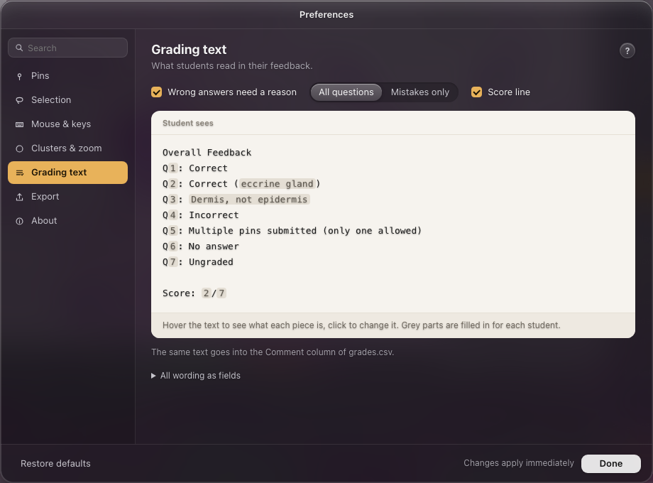

# What students see

Every student gets a short feedback note built from your grades. The same text goes into their own `feedback/<name>.txt` file and into the **Comment** column of `grades.csv`.

```
Overall Feedback
Q1: Correct
Q2: Neutrophil
Q3: Correct (borderline)
Q4: Multiple pins submitted (only one allowed)
Q5: No answer

Score: 2/5
```

## Changing the wording



Open [Preferences ▸ Grading text](preferences.md#grading-text). The **Student sees** box shows a sample note: click any piece of text to edit it in place. Grey chips such as the question number and the student's score are filled in for each student and can't be edited.

You can also choose:

- **All questions** or **Mistakes only**: list every question, or only the ones they got wrong.
- **Score line**: add the score at the end.
- **Wrong answers need a reason**: when off, a wrong answer with no reason reads *Incorrect*.

**All wording as fields** lists every piece of text with its default:

| Field | Default |
| --- | --- |
| Header | Overall Feedback |
| Question line | Q{q}: {text} |
| Correct | Correct |
| Correct + note | Correct ({note}) |
| Wrong + reason | {note} |
| Wrong, no reason | Incorrect |
| Multiple pins | Multiple pins submitted (only one allowed) |
| No answer | No answer |
| Not graded yet | Ungraded |
| Score line | Score: {score}/{total} |
| All correct | All answers correct. |

Tokens in braces are filled in for each student: `{q}` question number, `{text}` that question's result, `{note}` your reason or note, `{score}`, `{total}` and `{percent}`. **Reset wording** puts everything back.
