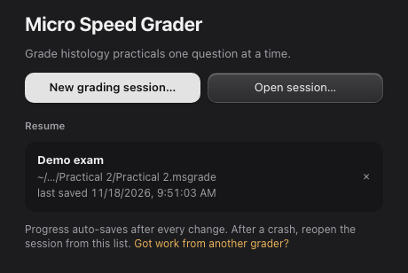
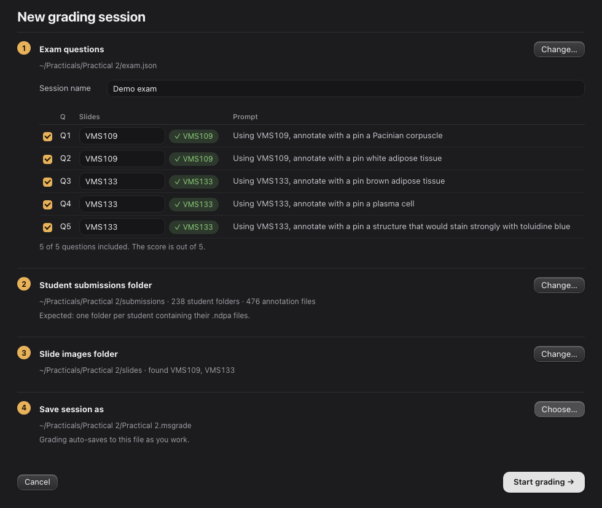

# Getting started

## What you need

- **The exam**: the exam PDF, or a JSON file listing the questions. Each question names the slide (or slides) it uses, for example `Q1. Using VMS109, place a pin on an eccrine sweat gland`.
- **The student submissions folder**: one folder per student, each holding that student's `.ndpa` annotation files (the pins they placed in NDP.view).
- **The slides folder**: the whole-slide images the exam uses (`.ndpi`, `.svs`, `.tif`, `.tiff`, `.mrxs`, `.scn` or `.vms`). File names must contain the slide ID, such as `VMS109`.

## The start screen

- **New grading session…** sets up a new session from the three things above.
- **Open session…** opens a `.msgrade` session file.
- **Resume** lists the last ten sessions you opened, with when each was last saved. Click one to carry on; the **×** only removes it from the list (the file stays where it is).
- **Got work from another grader?** opens a hand-off pack someone sent you. See [Grade with other people](handoff.md).

## Create a session

1. **Exam questions**: click **Choose exam PDF / JSON…**. The app reads every line shaped like `Q1. Using VMS123, …` and lists the questions in a table. Edit the session name if you like.
2. **Student submissions folder**: click **Choose folder…** and pick the folder that holds one folder per student. The app shows how many student folders and annotation files it found.
3. **Slide images folder**: click **Choose folder…** and pick the folder of slides. Each question's slides are marked **✓** when found or **missing** when not.
4. **Save session as**: click **Choose…** and pick where to keep the session file. It's pre-filled next to the submissions folder.
5. Click **Start grading →**.

**Start grading →** stays greyed out until at least one question is included and all three folders and the save location are chosen. Until then, the line next to it says what's still needed (hover over the button for the same list).

### Choosing which questions to grade

The table has a checkbox per question. Choosing the slides folder ticks only the questions whose slides were found. Untick a question to leave it out; the score is out of the number of included questions (shown under the table as *N of M questions included*).

You can correct the **Slides** cell if the exam lists the wrong slide ID: type the IDs separated by commas or spaces.

### How student pins are read

- Each first-level folder in the submissions folder is one student. Its name becomes the student's name, and a number in it becomes their UID.
- The slide ID comes from the `.ndpa` file name (`VMS109`).
- A pin's title is matched to a question number (*Q3*, *question 3*, *#3*…). On a slide that only one question uses, every pin belongs to that question.
- If a slide is used by several questions and the pin's title doesn't say which, the pin is shown on every candidate question with a **?** badge. Grading it assigns it to the question you graded it under.
- Shapes other than pins (circles, outlines) count as a pin at their centre.
- Limits that stop a damaged file from slowing the app: 2 MB per annotation file, 200 annotations per file and 50 pins per student per slide.

## Things to check

Once the exam and the submissions folder are chosen, the app reads every student's files. If anything looks wrong, step 2 shows **⚠ N things to check · Review**. Click **Review** to see each problem, what it means and what to do, with the students and files it affects. Long lists are cut short: click **Show all** to see the rest.

You can start grading anyway. To fix something, change the files in the submissions folder, then click **Check again**.

| Problem | What it means | What to do |
| --- | --- | --- |
| **Nothing to grade** | A student's folder has no pins the app can use (no `.ndpa` files, or none for the exam's slides). | Check whether the student submitted. If they did, put their `.ndpa` files in their folder. |
| **Missing a slide** | The student has no file for a slide an included question uses, so they have no answer for it. | If the file is there under another name, rename it so it includes the slide ID. |
| **No slide ID in the file name** | The app can't tell which slide the file is for, so its pins are left out. | Rename the file so it includes the slide ID, e.g. `VMS109.ndpi.ndpa`. |
| **Slide not in the exam** | No question uses that slide, so its pins are left out. | Usually nothing. If the student typed the wrong slide ID, rename the file. |
| **Pin names a question not on that slide** | A pin titled, say, *Q9* is on a slide that's only for Q2. It's still graded with that slide's questions. | Look at it when you grade that slide: the student may have mislabelled the pin or used the wrong slide. |
| **Too many pins** | Only the first 50 pins per student per slide are kept. | Open the file in NDP.view if you need the rest. |
| **File too large** | Annotation files over 2 MB are skipped; a real one is a few KB. | It's probably damaged. Ask the student to save it again from NDP.view. |
| **File can't be read** | The file isn't valid annotation data, so it was skipped. | Ask the student to save it again from NDP.view. |

Files for a question you've left out (unticked) aren't checked.

## Saving and backups

There's no Save button: the session saves itself a moment after every change, and whenever you change image or close the session. The top bar shows **Saving…**, then **✓ Saved**.

Each save keeps the previous version next to it as `yoursession.msgrade.bak`. If the session file is ever damaged, opening it falls back to the backup automatically.

To stop for the day, click the close button at the right of the top bar (**Save and close session**). Next time, click the session under **Resume**.

## Updates

On launch the app quietly checks for a new version. When there is one, a banner offers **Install & restart** (your session is saved first) or **Later**. You can also choose **Micro Speed Grader ▸ Check for Updates…** from the menu bar.
