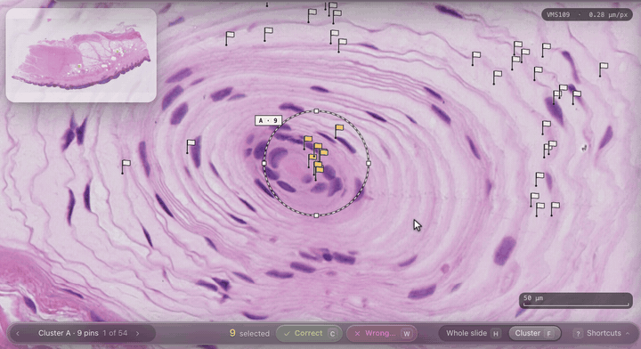
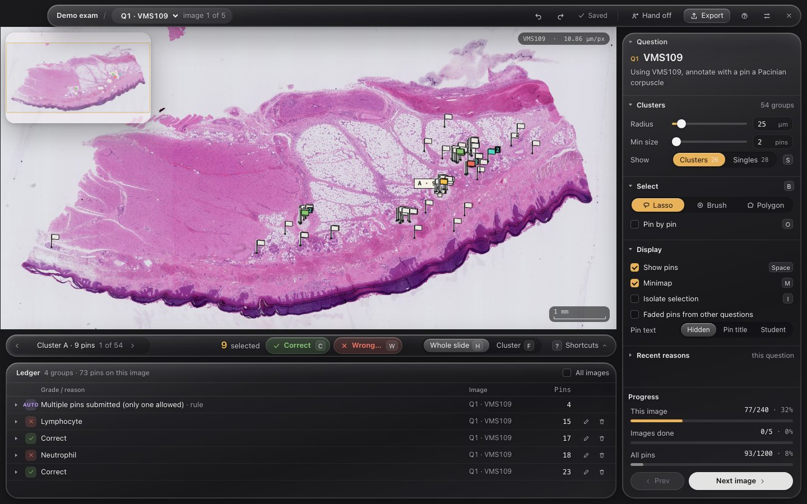
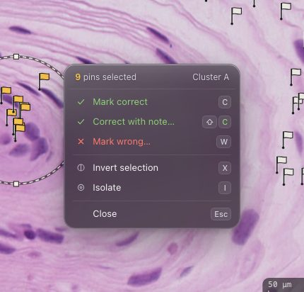
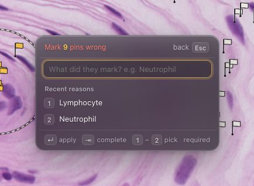

# Grading

You grade one **image** at a time: one question on one slide, with every student's pin for that question. Pins that sit close together are grouped into **clusters**, biggest first, so the common answers come up first and you can grade dozens of students with one key.

## The grading screen

- **Top bar**: the session name, the image menu (*Q1 · VMS109*, with *image 2 of 5* below it), undo and redo, the save status, **Hand off**, **Export**, Preferences, help and close.
- **The slide**, with the students' pins, the current cluster's dashed ring, a minimap (top left) and a scale bar.
- **Bottom toolbar**: previous/next cluster, how many pins are selected, **Correct**, **Wrong…**, the **Whole slide / Cluster** zoom switch and **Shortcuts**.
- **Right panel**: the question text, cluster settings, selection tools, display options, recent reasons and progress. Click a section's heading to fold it away.
- **Ledger** (bottom): every grade you've given. See [The ledger and undo](ledger.md).

## Grade a cluster

The app opens on the biggest cluster and selects its ungraded pins.

1. Look at what the pins in the ring are on. Zoom with the scroll wheel; **F** zooms back to the cluster, **H** shows the whole slide.
2. If they're right, press **C** (or click **Correct**). They turn green and the next cluster comes up.
3. If they're wrong, press **W** (or click **Wrong…**), type what they marked instead (for example *Neutrophil*) and press **↵**. That reason goes into those students' feedback.
4. When the ring holds a mix, select just the right pins first, with the lasso, brush or polygon. See [Selecting pins](selecting.md).

Press **]** to skip to the next cluster and **[** to go back. When an image is done, the next image comes up from the **Next image** button or **⌘→**.

> Grading pins that already have a grade moves them to the new grade. Nothing is graded twice.

### Correct with a note

**⇧C** (or ⇧-click **Correct**) marks the selection correct and lets you add a note, such as *Correct, but borderline*. The note shows in the student's feedback as *Correct (note)*.

## The grade menu

Click a pin, press **↵**, or right-click without dragging to open the grade menu for the selection:

| Item | Key | What it does |
| --- | --- | --- |
| Mark correct | C | Grade the selection correct |
| Correct with note… | ⇧C | Correct, with a note for the student |
| Mark wrong… | W | Grade it wrong and give a reason |
| Invert selection | X | Select the other ungraded pins on this image instead |
| Isolate | I | Hide every other pin |
| Remove grade | U | Make the selected pins ungraded again |
| Close | Esc | Close the menu |

## Reasons for wrong answers

When you mark pins wrong, the reason box suggests reasons you've used before: this question's first, then the rest of the exam.

- Press **1**–**9** (on an empty box) to pick a suggestion, or **⌘1**–**⌘9** while typing.
- **↑ ↓** highlight a suggestion and **⇥** completes it.
- **↵** applies, **Esc** goes back.

The **Recent reasons** section of the right panel lists this question's last few reasons with how many pins each has. Click one to mark the current selection wrong with that reason.

By default a reason is required. To allow blank reasons (students then read *Incorrect*), turn off **Wrong answers need a reason** in [Preferences ▸ Grading text](preferences.md#grading-text).

## Pins that grade themselves

### Double pins

A student who placed more than one pin for the same question gets a **2** badge on their pins. They're counted as done and marked wrong with *Multiple pins submitted (only one allowed)*, shown in the ledger as an **AUTO** row. If you grade one of their pins yourself, your most recent grade counts instead.

### No answer

A student with no pin for a question is marked wrong with *No answer* in the export. There's nothing to grade on the slide.

### Unlabelled pins (?)

A pin whose title doesn't say which question it answers, on a slide that several questions use, shows a **?** badge and appears on each of those questions. Grade it on the question it answers: that also assigns it. **Remove grade** undoes the assignment.

## Progress

The **Progress** section shows three bars: **This image**, **Images done** and **All pins**. When every pin is graded a banner offers **Export grades**. See [Exporting grades](export.md).

## Showing the pins differently

The right panel's **Display** section:

- **Show pins** (**Space**): hide the pins to see the tissue underneath. With pins hidden you can paint the structure instead; see [Paint with pins hidden](selecting.md#paint-with-pins-hidden).
- **Minimap** (**M**).
- **Isolate selection** (**I**): only the selected pins are drawn.
- **Faded pins from other questions**: show the other questions' pins on the same slide, greyed out.
- **Pin text**: label each pin with nothing, its *Pin title* (what the student typed) or the *Student* name.
