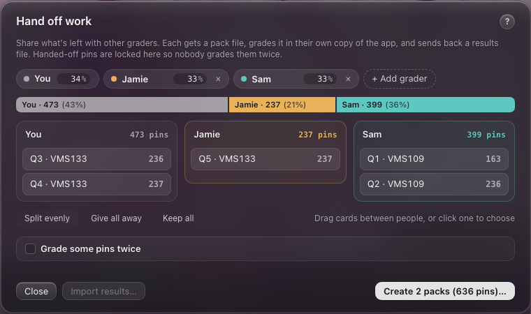
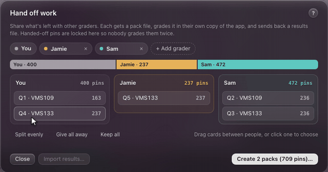
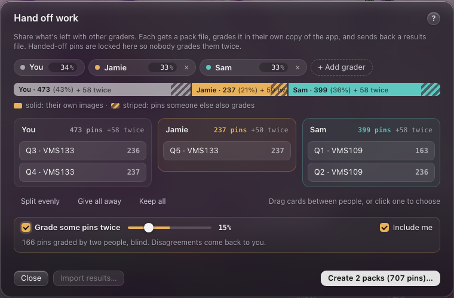
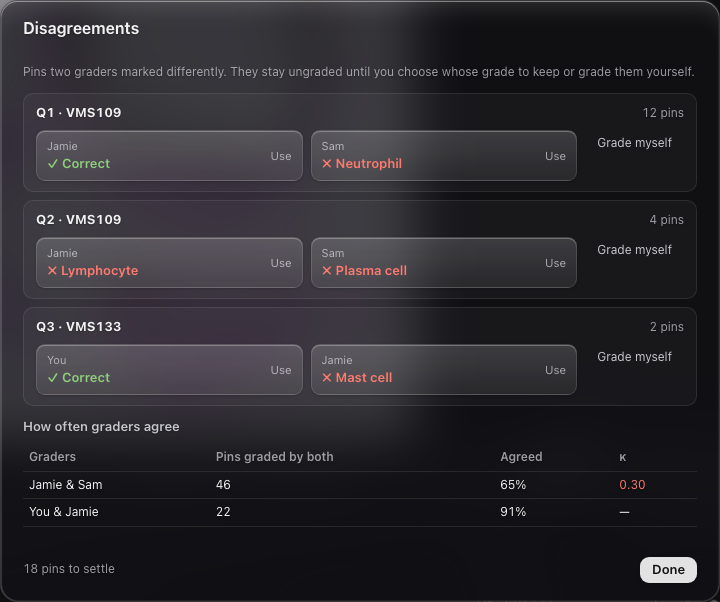

# Grade with other people

Split a grading session with one or more other graders. You (the **host**) keep the session. Each other grader (a **guest**) gets part of the remaining work as a file. They grade it on their own computer and send back a results file. You merge it in.

There is no server and no account. The files travel however you like: email, Google Drive, a shared folder or a USB stick.

```
 host ── Exam - Jamie.msgpack ──▶ guest grades only that work
 host ◀── Exam - Jamie.msgresult ── guest
```



## Before you start

- Both people need Micro Speed Grader installed.
- The guest needs their own copy of the course slides folder (the same `.ndpi` files as the host). The pack holds the students' pins and answers, not the slide images, so it stays small.
- The guest does **not** need the exam file or the submissions folder. Everything they need is inside the pack.

## Host: split the work

1. Open your session and click **Hand off** in the top bar (next to Export).
2. Type the first grader's name. Click **+ Add grader** for each extra person (× removes one).
3. Choose who grades what. Each card is one image: a question on one slide. The number on a card is how many pins on it are still ungraded. Each person has a column with their pin total.
   - **Drag a card** to someone's column.
   - Or **click a card**: with one other grader it swaps sides; with more, a menu asks who should get it.
   - Or type each person's **share** in the **%** field on their name, for example 50% for you and 25% each for two TAs. Changing one share rescales the others so they still add up to 100%, and the cards re-split to match. The bar shows the split actually achieved.
   - **Split evenly** gives everyone, you included, the same share. **Give all away** sets your share to 0%. **Keep all** gives everything back to you.

   An image is never split, so every answer to a given image is marked by the same person. With only a few images, the split can only get close to the shares you asked for. The coloured bar at the top shows how many pins each person will grade.
4. Click **Create pack (N pins)…** (or **Create N packs…** for several graders). With one grader you choose where to save the file; with several, you choose a folder and get one `.msgpack` per person, named after them. Send each person their own file.



If you have an [answer key](answer-key.md), apply it first: pins it grades are no longer "remaining", so you only hand off the answers the key couldn't place. The pack carries the key as suggestions.

The handed-off pins are now **locked** in your session:

- They're drawn faint on the slide and can't be graded.
- The image list shows `→ name` beside images that are out.
- A banner on the image says how many pins are with the guest.

You can keep grading everything else, and you can hand off more later. Each pack only contains work that isn't already out.

## Guest: grade the pack

1. On the start screen, click **Got work from another grader?** and choose the `.msgpack` file.
2. Choose your slides folder. If slides the pack needs are missing, the app names them.
3. Choose where to save your work. This creates an ordinary session file (`.msgrade`) that auto-saves, so you can close the app and resume later from the start screen.
4. Grade as usual. You only see the images you were given. Pins that belong to the host are shown faint and can't be graded.
5. The top bar shows **Send results · done/total**. When you're finished (or whenever the host asks), click it and save the `.msgresult` file. Send that file back to the host.

You can send results more than once. Each file holds everything you've graded in the pack so far, and importing a newer file updates your earlier grades.

Some of your pins may also be graded by someone else (see [Grade some pins twice](#grade-some-pins-twice)). You aren't told which, and you never see the other person's grade: grade every pin as you normally would.

## Host: merge the results

1. Open **Hand off** and click **Import results…**, then choose the `.msgresult` file.
2. The guest's grades are merged into your session. The pack shows as *returned*, with the number of grades merged.

With several graders, import each person's results file as it arrives, in any order.

Merging is a single step you can undo with **⌘Z**.

Only pins that were in that pack are taken from the file. If you already graded one of those pins yourself (for example after a recall), **your grade is kept** and the guest's is skipped. The confirmation message says how many were skipped.

### Sending results again

If a grader sends a second results file (say a partial one first, then the finished one), import the new file too. Their earlier grades are updated to match; anything you graded yourself in the meantime still keeps your grade.

### Submissions that change while a pack is out

If you [rescan](getting-started.md#new-and-changed-submissions) while a pack is out and a student has changed or removed a pin that's in it, the guest's grade for that pin can no longer count: it's for an answer the student no longer has.

- The rescan message says how many changed pins are in a pack that's still out.
- Under **Packs**, the pack shows **N pins changed since sent**.
- The student's new pin is not in the pack: you grade it yourself.
- When you import the results, the message says how many of the guest's grades were for pins that changed. Those grades are kept with the old pins in [Changed submissions](getting-started.md#review-changed-submissions), where **Carry grade over** gives the new pin the guest's grade and **Restore** brings a removed pin back with it.

### Who graded what

Every grade remembers who gave it. In the [ledger](ledger.md), grades from other graders show their name beside the reason, for example **Jamie**. Pins two people agreed on show both names, such as **Jamie & Sam**. Grades with no name are yours.

## Replacing another grader's grade

You can regrade, edit or remove any grade, including ones another grader gave. When you do, a notice appears over the slide: *12 pins were graded by Jamie. Your grade replaced theirs.*

- **Undo** puts their grade back.
- **Don't warn again** turns the notice off until you quit the app.

The pins then count as yours.

## Grade some pins twice

To check that everyone is marking the same way, give some pins to two people. Each grades them **blind**, without seeing the other's grade, and the app compares the two.



1. In **Hand off**, split the work as usual.
2. Tick **Grade some pins twice** and choose a share of the pins, from 5% to 50%. That share is picked at random from every image, and each picked pin also goes to a second person.
3. Choose whether to **Include me**:
   - **On**: you're one of the graders. Some of your own images' pins also go to another grader, and you get some of theirs to grade in your session.
   - **Off**: overlaps are only between the other graders. Your own images are graded by you alone, and you only settle disagreements.
4. Each person's column shows how many extra pins they grade second (**+N twice**), and the bar at the top shows them as a striped end on that person's colour. Click **Create packs** as usual.

Grading twice needs at least two people taking part.

When both grades for a pin are in:

- **They agree**: the pin gets that grade. Two wrong answers agree when their reasons mean the same thing: case, punctuation, plurals and small typos are ignored, and reasons that share a main word (*Neutrophil* and *neutrophils*, or *Dermis, not epidermis* and *epidermis*) count as the same. A blank reason agrees with anything.
- **They disagree** (one says correct and the other wrong, or the reasons are clearly different, such as *Neutrophil* and *Lymphocyte*): the pin stays ungraded and is flagged for you.

If you're one of the graders, you grade your overlap pins in your own session as normal. When your grade disagrees with one already returned, a notice tells you straight away.

## Settle disagreements



When there are disagreements, a red **Disagreements** button with a count appears in the top bar, and those pins get a red **!** dot on the slide. Click the button to see them, grouped by image and by what each person said, for example *Q2 · VMS109 — Jamie: ✓ Correct, Sam: ✗ Neutrophil — 12 pins*.

For each group:

- Click a grader's grade to **use** it for all those pins.
- **Grade myself** shows the pins on the slide, selected, so you can grade them yourself. Your grade settles them.

Settling is a normal step you can undo with **⌘Z**. Pins with disagreements count as ungraded in the export until you settle them, and the Export window shows how many are left.

### How often graders agree

The Disagreements window also shows, for each pair of graders, how many pins they both graded, how often they agreed, and **κ** (Cohen's kappa on correct / wrong: how much more they agree than chance would). Above 0.8 is very good. Below 0.6, shown in red, suggests the two read the question differently and are worth a quick calibration chat. κ shows **—** when one of them gave every shared pin the same grade, because there's then nothing to measure beyond the agreement percentage.

## Taking work back (recall)

Under **Packs** in the Hand off window, click **Recall** next to a pack that's still out. Its pins unlock in your session right away, so you can grade them or hand them to someone else.

If the guest sends results for a recalled pack later, you can still import them. Only pins you haven't graded since get merged. If you handed those pins to someone else meanwhile and both people graded them, the two grades are compared like [pins graded twice](#grade-some-pins-twice): agreements are kept and disagreements come to you.

Recalling a pack with pins that were to be graded twice leaves those pins to the other grader alone.

## What's in the files

| File | Made by | Contains |
| --- | --- | --- |
| `.msgpack` | host | Session name, questions, students and their pins and answers, grades so far, and slide file names. No slide images. |
| `.msgresult` | guest | The guest's grades and feedback text, for pins in that pack only. |

Both files contain student answers, so share them the way you'd share any other grading material.

## Troubleshooting

- **"That folder is missing …"**: the guest picked a folder without the slides the pack uses. Choose the folder that has those `.ndpi` files.
- **"These results are for a pack that wasn't made from this session."**: the results file came from a pack made in a different session file. Open the session that created the pack, then import again.
- **"Give each grader a different name."**: two graders have the same name. Names are used for the file names and the pack list, so each must be unique.
- **"This isn't a Micro Speed Grader hand-off pack / results file."**: the wrong file was chosen.
- **"…damaged."**: the file was cut short or changed after it was saved. Ask for it again.
- **"…made by a newer version of Micro Speed Grader."**: the other person's app is newer than yours. Choose **Micro Speed Grader ▸ Check for Updates…**, then try again.
