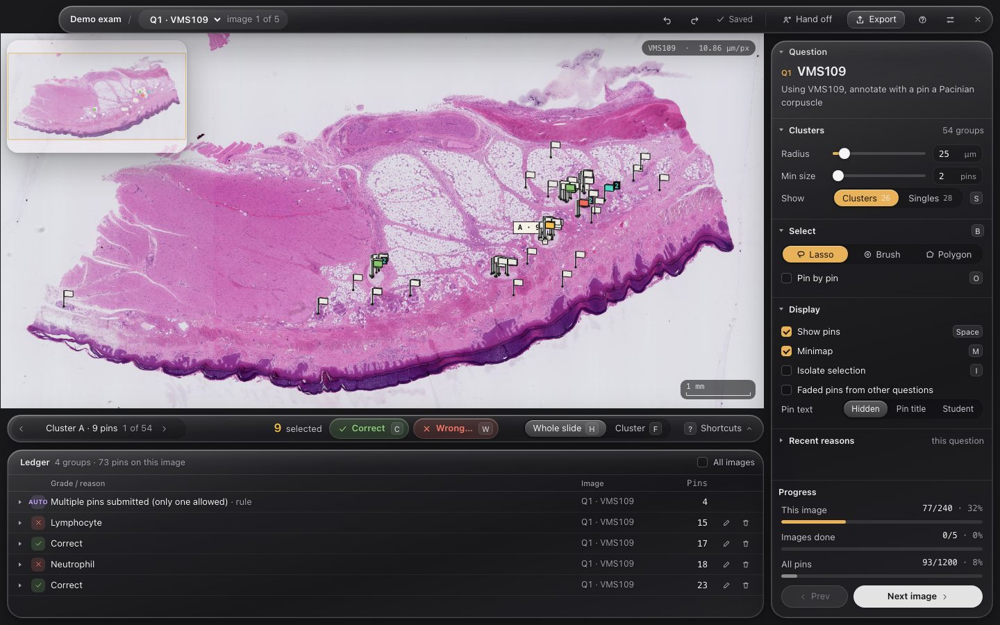

# Micro Speed Grader Help

Micro Speed Grader marks virtual-microscopy practicals one question at a time. Students drop a pin on a structure in a whole-slide image. The app gathers every student's pin for a question onto one slide, groups pins that land on the same structure, and lets you grade a whole group with one key press. When you're done it exports a grades spreadsheet and a feedback note for each student.

**New here?** Read [Getting started](getting-started.md), then [Grading](grading.md). Keep [Keyboard shortcuts](shortcuts.md) open while you work: most grading is done from the keyboard.

> Hover over any control in the app to see what it does. When the tooltip shows a **?**, click it to jump to the matching section here.

## Topics
