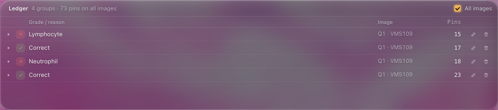

# The ledger and undo

The **Ledger** under the slide lists every grade on this image: one row per group of pins you graded together, with its reason and pin count. Tick **All images** to see the whole exam.

## What you can do with a row

- **✓ / ✗ badge**: click to switch the group between correct and wrong.
- **The reason**: click it to jump to that image and select those pins; double-click to edit the text (**↵** saves, **Esc** cancels). The pencil does the same.
- **Trash**: remove the grade. The pins become ungraded again.
- **Caret** (left): show one chip per student. Click a chip to show that pin; its **×** removes just that student from the group.

Rows read *no reason* for wrong answers without one, and *Correct — note* for correct answers with a note.

The **AUTO** row lists students with more than one pin (see [Double pins](grading.md#double-pins)). It's a rule, not a grade, so it can't be edited.

## Undo and redo

- **⌘Z** undoes the last change; **⇧⌘Z** (or **⌘Y**) redoes it. The arrows in the top bar do the same.
- Everything that changes grades can be undone: grading, removing grades, ledger edits and merged hand-off results. Up to 200 steps are kept.
- Undo history is cleared when you open a session.
