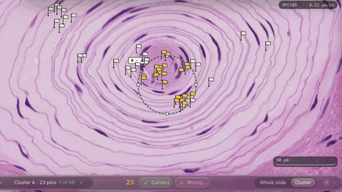
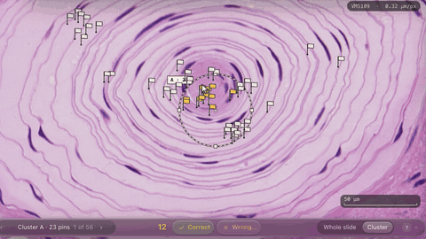
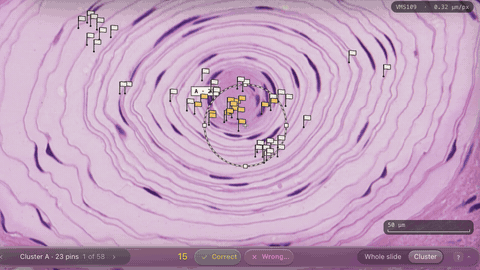
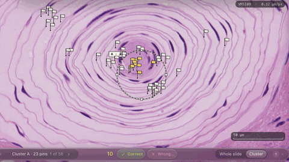
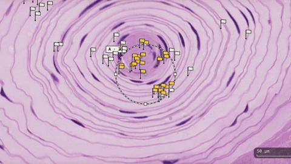
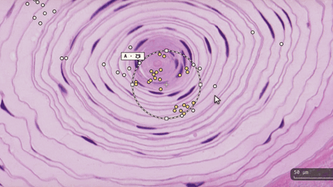
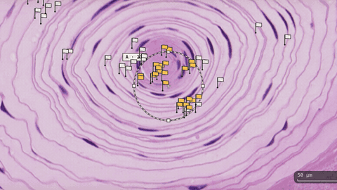

# Selecting pins

Usually the app's cluster selection is all you need: press **C** or **W**. When a cluster holds a mix of right and wrong answers, select the pins yourself first. Turn tools on and off in [Preferences ▸ Selection](preferences.md#selection).

## The mouse

By default the **right** button selects and the **left** button pans the slide. Swap them in [Preferences ▸ Mouse & keys](preferences.md#mouse--keys) (**Left selects**). Scroll to zoom.

When more than one tool is on, the **Select** section of the right panel shows a switcher. **B** cycles through the tools.

## Lasso

Drag a loop around the pins. When you let go, the grade menu opens beside them.

- **⌘-drag** adds to the selection (the menu stays closed).
- **⇧-drag** selects everything *outside* the loop.
- **⌥-drag** draws a rectangle.
- **⌘-click** a pin adds or removes just that pin.
- **X** inverts the selection.

## Brush

Paint over the pins. Painting replaces the selection and opens the menu.

- **⇧** adds and **⌥** removes, without opening the menu.
- **-** and **=** make the brush smaller or bigger. The size slider is in the **Select** section.

## Polygon

Click to place corners around the pins. Close the shape by clicking the first corner, double-clicking, or pressing **↵**.

- **⌫** removes the last corner; **Esc** cancels.
- **⌘** on the first click adds to the selection; **⇧** selects the outside.

## Paint with pins hidden

Useful when the pins hide the very structure you need to judge.

1. Press **Space** to hide the pins.
2. Paint over the correct structure with any tool.
3. Press **Space** again. The pins inside the painted area are selected, and the cluster's other pins get a dashed red ring.
4. Press **C**: painted pins are marked correct, and you're asked for a reason for the rest of the cluster (*Rest of cluster · N painted marked correct*). Both grades are one undo step.

In the grade menu, **Only these correct** (**O**) marks the painted pins correct and leaves the rest ungraded. **Esc** clears the paint.

## Pin by pin

For a messy cluster, grade one pin at a time. Tick **Pin by pin** in the **Select** section, or press **O**. Only one pin is shown; **← →** move between the cluster's ungraded pins, and grading one moves to the next.

## Spotlight and small pins

- **Spotlight on hover**: hovering a pin hides all the others, so you can see what's under it.
- **Small pins when zoomed**: past a zoom level you choose, markers shrink to a dot or crosshair so they cover less tissue.

## Click to add / remove

With this on, clicking a pin adds it to or removes it from the selection instead of opening the menu. **⌘-click** opens the menu.

## Moving the cluster ring

Drag the ring's tag, its centre or the ring itself to move it; drag a square handle to resize it. The ungraded pins inside are selected again.
