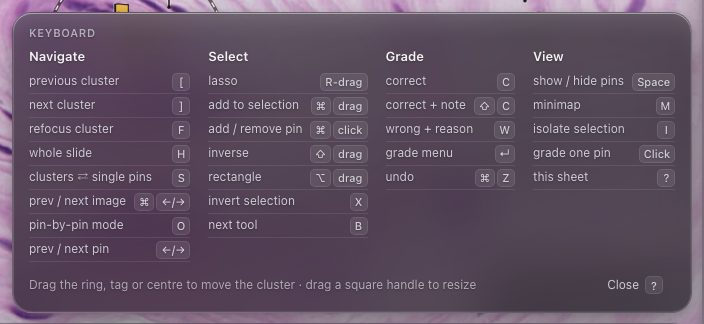

# Keyboard shortcuts

Press **?** while grading to show the shortcuts sheet over the slide. On Windows, use **Ctrl** where this page says **⌘**.

## Grading

| Key | Action |
| --- | --- |
| C | Mark the selection correct (with painted pins: painted ✓, rest ✗) |
| ⇧C | Correct with a note |
| W | Wrong, with a reason |
| ↵ | Open the grade menu |
| X | Invert the selection |
| ⌘Z | Undo |
| ⇧⌘Z or ⌘Y | Redo |

## Moving around

| Key | Action |
| --- | --- |
| ] or N | Next cluster |
| [ or P | Previous cluster |
| ⌘→ / ⌘← | Next / previous image |
| F | Zoom to the selection or cluster |
| H | Whole slide |
| S | Switch between clusters and singles |
| O | Pin by pin on or off (when enabled) |
| → / ← | Next / previous pin (pin by pin) |

## View and tools

| Key | Action |
| --- | --- |
| Space | Show or hide pins (can be changed) |
| M | Minimap (can be changed) |
| I | Isolate the selection |
| B | Next selection tool |
| - / = | Smaller / bigger brush |
| Esc | Clear painted area and isolation |
| ? | Shortcuts sheet |
| K | Use the answer key's suggestion for this cluster (Suggest only) |
| / | Find a student (see [Look up a student](students.md)) |

## In the student panel

| Key | Action |
| --- | --- |
| ↑ ↓ then ↵ | Choose a student from the search results |
| ↵ | Mark wrong with the reason typed |
| Esc | Clear the search, cancel a reason, or close the panel |

## While selecting

| Tool | Keys |
| --- | --- |
| Lasso | ⌘-drag add · ⇧-drag outside · ⌥-drag rectangle · ⌘-click add/remove a pin |
| Brush | ⇧ add · ⌥ remove |
| Polygon | ↵ close · ⌫ remove last corner · Esc cancel · ⌘ first click add · ⇧ outside |

## In the grade menu and reason box

| Key | Action |
| --- | --- |
| C or ↵ | Mark correct |
| ⇧C | Correct with note |
| W | Mark wrong |
| O | Only these correct (painted pins) |
| X / I / U | Invert / isolate / remove grade |
| 1–9 | Pick a suggested reason (⌘1–9 while typing) |
| ↑ ↓ then ⇥ | Choose and complete a suggestion |
| Esc | Back / close |

## Menu bar

| Key | Action |
| --- | --- |
| ⌘N | New grading session |
| ⌘O | Open session |
| ⌘E | Export grades |
| ⌘W | Close session (or the Help or Preferences window) |
| ⌘, | Preferences |
| ⌘? | This help |
