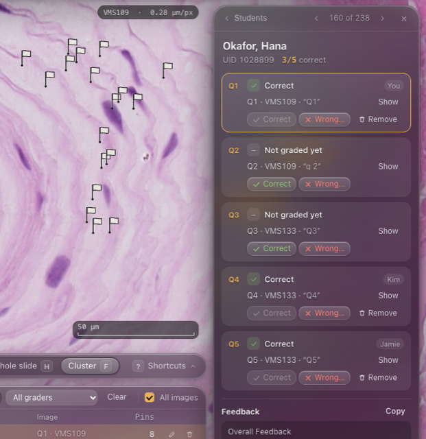

# Look up a student

When a student asks about their grade, you don't need to hunt image by image. The student panel shows everything about one student: every question, what they answered, who graded it and why, and the feedback they'll get. You can check each pin on the slide and change a grade from there.

## Open a student

- Click **Find student** in the top bar, or press **/**. Type part of a name or a UID, then click the student (or use **↑ ↓** and **↵**).
- Or click a student's name in the [ledger](ledger.md#what-you-can-do-with-a-row). That shows their pin and opens their answers at that question.

The panel sits over the right-hand panel, so the slide stays in view. **‹ ›** at the top step to the previous or next student (sorted by surname). **‹ Students** goes back to the search. **Esc** or **×** closes it.

## What it shows

At the top: the student's name, UID and score (for example *3/5 correct*). Then one card per question, in order:

| It says | Meaning |
| --- | --- |
| **Correct** / **Wrong** | Graded. The reason or note is below, and the badge on the right says who graded it: *You*, another grader's name, or two names when two graders agreed. |
| **Marked wrong: 2 pins** | The student placed more than one pin, so the [double-pin rule](grading.md#double-pins) marked it wrong (**AUTO**). |
| **No answer** | No pin for this question. |
| **Not graded yet** | Nobody has graded the pin. |
| **Unlabelled pin, not graded** | The pin's title doesn't say which question it answers. See [Unlabelled pins](grading.md#unlabelled-pins). |
| **With Jamie** | The pin is out with another grader in a [hand-off pack](handoff.md). |
| **Graders disagree** | Two graders marked it differently. See [Settle disagreements](handoff.md#settle-disagreements). |

Each pin is listed with its image and the title the student gave it. **Show** jumps to that image and zooms to the pin.

At the bottom is the **Feedback** the student will get, worded as in [Preferences ▸ Grading text](preferences.md#grading-text). **Copy** puts it on the clipboard, for a reply email.

## Change a grade

Under each answer:

- **Correct**: mark the student's pin correct.
- **Wrong**: type a reason (earlier reasons are suggested) and press **↵**.
- **Remove**: make the answer ungraded again.

The change applies to this student's pin only: it's taken out of the group it was graded with, and the rest of that group keeps its grade. Each change is one step for **⌘Z**. When you replace another grader's grade, the usual [notice](handoff.md#replacing-another-graders-grade) appears.

For a student with two pins, grading here grades both, and your grade replaces the AUTO rule. A pin that's out with another grader can't be changed until their results come back.
